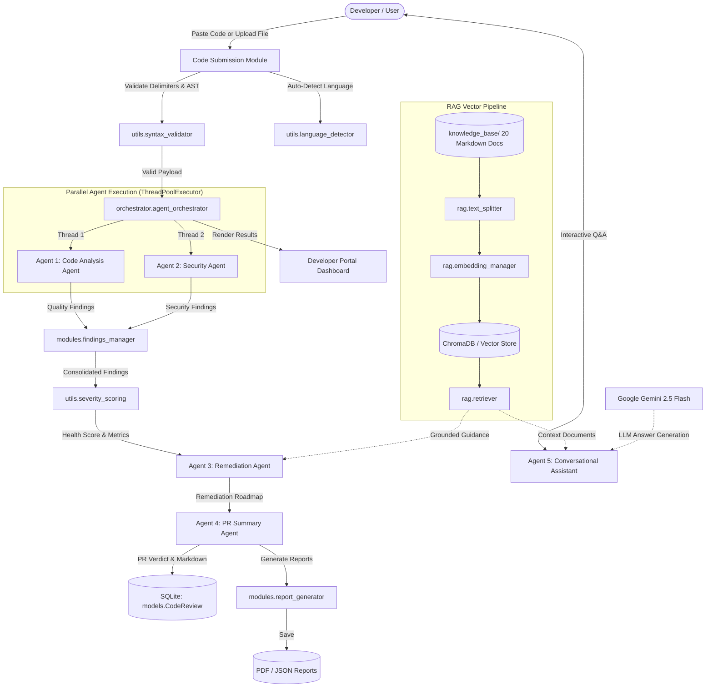
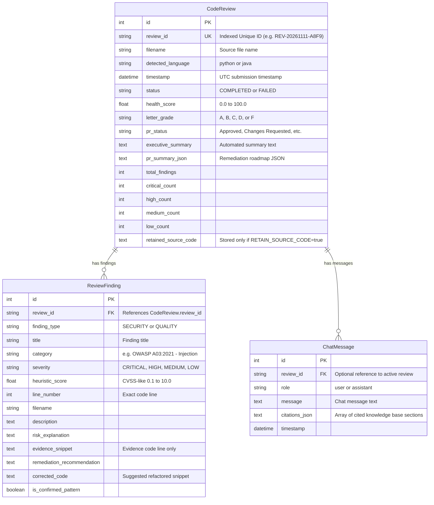

# AI Code Review & Security Analysis Agent

An enterprise-grade, multi-agent AI system designed to review Python and Java source code, detect code quality anti-patterns, identify OWASP Top 10 security vulnerabilities, generate prioritized remediation plans with corrected code examples, and provide an interactive RAG-grounded conversational assistant.

---

## 1. Project Introduction
**AI Code Review & Security Analysis Agent** (`AI_code_review`) is an end-to-end multi-agent software auditing platform. The system operates on a zero-trust model where submitted source code is treated as untrusted data: it is never compiled or executed on the host, but instead inspected via static syntax trees (Python AST), structural lexers (Java), pattern heuristics, and a persistent Retrieval-Augmented Generation (RAG) vector pipeline.

The platform provides an intuitive, responsive developer portal (Bootstrap 5, Chart.js) capable of ingesting directly pasted code snippets or uploaded `.py` and `.java` files, auto-detecting the programming language, computing an objective Code Health Score (0–100), and producing GitHub-style pull request review verdicts.

---

## 2. Problem Statement
Modern continuous integration and deployment (CI/CD) pipelines move faster than manual security audits can keep pace. Vulnerabilities such as SQL Injection, Command Injection, Insecure Deserialization, and Path Traversal frequently escape to production when developers lack instantaneous defensive feedback. Moreover, existing linters either bombard developers with noisy false positives without explaining the underlying risk or lack contextual remediation advice.

There is a critical academic and industrial need for an intelligent system that:
1. Integrates code quality analysis with application security auditing.
2. Explains *why* a particular code construct is dangerous and *how* to refactor it securely.
3. Operates deterministically even in air-gapped, offline environments without external API keys, while scaling seamlessly when connected to Large Language Models (Google Gemini 2.5 Flash).

---

## 3. Objectives
- **Automatic Language Detection**: Identify Python and Java source files and pasted snippets automatically without manual user toggles.
- **Concurrent Multi-Agent Review**: Execute Code Analysis and Security Scanning agents in parallel via thread pools for low-latency review.
- **OWASP Vulnerability Coverage**: Detect 14 major vulnerability classes with line-level evidence and CVSS-inspired risk heuristics.
- **Grounded Remediation**: Synthesize actionable fixes and side-by-side corrected code grounded on a 1,119-line secure coding knowledge base.
- **PR Merge Governance**: Deliver GitHub-style pull request reviews with formal verdicts: *Approved*, *Approved with Suggestions*, or *Changes Requested*.
- **Interactive Conversational Assistant**: Enable developers to chat with an AI assistant that answers security questions and cites official documentation.
- **Audit Exportability**: Produce downloadable audit reports in both PDF and JSON formats.

---

## 4. Technologies Used

### Backend
- **Python 3.10–3.12**: Core runtime environment.
- **Flask**: Microframework delivering web routes, template rendering, and REST API endpoints.
- **Flask-CORS**: Cross-Origin Resource Sharing middleware.
- **SQLAlchemy & SQLite**: Relational database ORM and lightweight file storage (`ai_code_review.db`).
- **Python AST (`ast` module)**: Native Abstract Syntax Tree parser for deep Python inspection.
- **Concurrent Futures (`ThreadPoolExecutor`)**: Multi-agent parallel task execution.

### AI and RAG Pipeline
- **Google Gemini API (`gemini-2.5-flash`)**: High-speed conversational reasoning and LLM generation.
- **ChromaDB**: Native persistent vector database storing chunk embeddings.
- **Sentence Transformers (`all-MiniLM-L6-v2`)**: Dense semantic text embeddings.
- **Deterministic CRC32 Fallback Vectorizer**: Zero-dependency offline embedding generator ensuring 100% test reliability without external model downloads.
- **Section-Aware Markdown Text Splitter**: Header-preserving chunking engine.

### Frontend
- **HTML5 & CSS3**: Clean, white/light theme modern security dashboard.
- **Bootstrap 5.3.2**: Responsive grid layout, modals, tabs, and navigation components.
- **Bootstrap Icons 1.11.3**: Crisp iconography.
- **Chart.js 4.4.1**: Dynamic doughnut and distribution visualizations.

### Reports & Utilities
- **ReportLab Platypus / Pure-Python PDF Engine**: Multi-page PDF generation.
- **JSON**: Machine-readable review interchange.

---

## 5. System Architecture



---

## 6. Folder Structure

```
AI_code_review/
│
├── app.py                         # Main Flask application and REST API entry point
├── config.py                      # Centralized configuration and path management
├── requirements.txt               # Python package dependencies
├── .env.example                   # Environment variable template
├── .env                           # Local environment configuration
├── .gitignore                     # Git ignore definitions
├── README.md                      # Comprehensive project documentation
│
├── agents/                        # The Five AI Agent implementations
│   ├── __init__.py
│   ├── code_analysis_agent.py     # Agent 1: Code quality, smells, complexity, AST visitor
│   ├── security_agent.py          # Agent 2: OWASP Top 10 vulnerability scanner (Python & Java)
│   ├── remediation_agent.py       # Agent 3: Prioritized fix generator & refactored code
│   ├── pr_summary_agent.py        # Agent 4: GitHub PR review, health metrics, and merge verdict
│   └── code_assistant_agent.py    # Agent 5: RAG-powered chatbot with Gemini & offline fallback
│
├── orchestrator/                  # Multi-Agent Workflow Coordination
│   ├── __init__.py
│   └── agent_orchestrator.py      # ThreadPoolExecutor concurrency, persistence, error isolation
│
├── modules/                       # Core Business Logic Modules
│   ├── __init__.py
│   ├── code_submission.py         # Upload/paste handler, size limiter, auto-naming
│   ├── findings_manager.py        # Deduplication, sorting, filtering, and metric calculation
│   └── report_generator.py        # PDF (ReportLab & pure-Python) and JSON report generator
│
├── rag/                           # Retrieval-Augmented Generation (RAG) Pipeline
│   ├── __init__.py
│   ├── document_loader.py         # Markdown document parser and metadata extractor
│   ├── text_splitter.py           # Section-aware H2/H3 chunk splitter
│   ├── embedding_manager.py       # SentenceTransformers with deterministic CRC32 fallback
│   ├── vector_store.py            # ChromaDB client with persistent JSON vector store fallback
│   ├── retriever.py               # Top-K vector similarity search and citation formatting
│   └── rag_pipeline.py            # End-to-end RAG orchestrator (indexing & context retrieval)
│
├── database/                      # Relational Persistence Layer
│   ├── __init__.py
│   ├── db.py                      # SQLAlchemy engine, declarative base, and session lifecycle
│   └── models.py                  # CodeReview, ReviewFinding, and ChatMessage models
│
├── utils/                         # Independent Utility Libraries
│   ├── __init__.py
│   ├── language_detector.py       # Independent Python vs Java language identifier
│   ├── syntax_validator.py        # Python AST & Java delimiter syntax validator
│   ├── severity_scoring.py        # CVSS-inspired heuristic scoring & Code Health Score formula
│   ├── validate_knowledge_base.py # Line counter and validator for knowledge base (>1001 lines)
│   └── helpers.py                 # ID generation, timestamps, snippet extraction, and sanitizers
│
├── knowledge_base/                # 20 Comprehensive Markdown Documents (1,119 Lines)
│   ├── owasp_top10.md
│   ├── python_secure_coding.md
│   ├── java_secure_coding.md
│   ├── sql_injection_prevention.md
│   ├── xss_prevention.md
│   ├── csrf_protection.md
│   ├── authentication_security.md
│   ├── authorization_access_control.md
│   ├── secrets_management.md
│   ├── input_validation.md
│   ├── output_encoding.md
│   ├── cryptography_best_practices.md
│   ├── secure_file_handling.md
│   ├── command_injection_prevention.md
│   ├── path_traversal_prevention.md
│   ├── secure_deserialization.md
│   ├── python_code_quality.md
│   ├── java_code_quality.md
│   ├── clean_code_principles.md
│   └── secure_api_development.md
│
├── scripts/
│   ├── build_knowledge_base.py    # CLI indexing script to embed and persist knowledge base
│   └── generate_kb.py             # Knowledge base generator script
│
├── templates/                     # Jinja2 HTML5 Developer Portal Templates
│   ├── base.html                  # Global layout, navbar, notifications, and footer
│   ├── index.html                 # Welcome hero, architectural overview, and feature cards
│   ├── dashboard.html             # Chart.js analytics dashboard, metric cards, recent reviews
│   ├── submission.html            # Editor with auto language badge, file upload, and presets
│   ├── results.html               # Pull request review summary, PR verdict, health score
│   ├── findings.html              # Filterable findings list with severity and category badges
│   ├── remediation.html           # Side-by-side original vs corrected code comparisons
│   ├── assistant.html             # Conversational AI assistant chat interface with RAG citations
│   └── history.html               # Historical audit log table with search and report downloads
│
├── static/                        # Static Assets
│   ├── css/
│   │   └── style.css              # Custom professional light-theme software security styles
│   └── js/
│       ├── main.js                # Live language detection, file dropzone, clipboard copy
│       ├── dashboard.js           # Chart.js doughnut severity distribution rendering
│       └── assistant.js           # Asynchronous chat client, streaming indicators, suggestions
│
├── reports/                       # Generated PDF and JSON report artifacts
├── chroma_db/                     # Persistent ChromaDB vector store directory
│
└── tests/                         # Complete Automated Test Suite (27 Tests)
    ├── __init__.py
    ├── run_all_tests.py           # Standalone test runner (runs without pytest if needed)
    ├── test_language_detector.py  # Tests for extension & pattern language detection
    ├── test_code_analysis.py      # Tests for Python AST and Java quality rules
    ├── test_security_agent.py     # Tests for 14 OWASP vulnerabilities & false-positive checks
    ├── test_remediation.py        # Tests for roadmap prioritization & PR verdict logic
    ├── test_knowledge_base.py     # Tests for 1,001+ lines requirement & RAG retrieval
    ├── test_orchestrator.py       # End-to-end multi-agent pipeline tests (Python & Java)
    └── test_routes.py             # Flask HTTP routes, API endpoints, and report export tests
```

---

## 7. Responsibilities of All Five Agents

| Agent | Module | Primary Responsibilities |
|---|---|---|
| **Agent 1: Code Analysis Agent** | `agents/code_analysis_agent.py` | Uses Python AST to detect overly long functions (>35 lines), cyclomatic complexity (>8), excessive nesting depth (>=4), non-snake_case naming, mutable default arguments (`def f(x=[])`), bare `except:` clauses, wildcard imports, and dead imports. Analyzes Java for God classes (>300 lines), empty catch blocks, excessive parameters (>4), and loop string concatenation. |
| **Agent 2: Security Vulnerability Agent** | `agents/security_agent.py` | Scans Python and Java source code for 14 OWASP vulnerability classes: SQL Injection, Command Injection, XSS, Insecure Deserialization (pickle/ObjectInputStream), Path Traversal, Broken Crypto (MD5/SHA1/DES/ECB), Hardcoded Secrets (AWS keys, passwords), CSRF exemption, Sensitive Info Leaks, Insecure File Permissions, and Insecure Randomness. Distinguishes confirmed patterns from potential risks. |
| **Agent 3: Remediation Agent** | `agents/remediation_agent.py` | Receives findings from Agents 1 & 2. Queries the RAG knowledge base for context-grounded defensive guidelines. Prioritizes critical and high issues. Synthesizes explanations detailing *why* the original code is problematic and *why* the fix is safer. Provides side-by-side refactored code without modifying original source files. |
| **Agent 4: PR Summary Agent** | `agents/pr_summary_agent.py` | Formulates a GitHub-style pull request review. Evaluates merge readiness: assigns `Approved` (Health >= 90, 0 critical/high), `Approved with Suggestions` (Health >= 70, 0 critical, <=1 high), or `Changes Requested` (Critical > 0, High > 1, or Health < 70). Outputs an executive summary, observations, and prioritized roadmap. |
| **Agent 5: Conversational Code Assistant** | `agents/code_assistant_agent.py` | Implements a RAG-grounded conversational chatbot. Uses Google Gemini 2.5 Flash when configured; seamlessly falls back to a deterministic grounded rule engine when offline. Grounds all answers on retrieved knowledge base sections and active review findings with precise document citations. |

---

## 8. Explanation of All Six Modules

1. **`utils/language_detector.py`**:
   Autonomous language classification engine. Prioritizes file extension authority (`.py` vs `.java`), rejects unsupported file formats (`.cpp`, `.rb`, etc.), and analyzes raw pasted code via Python AST parseability and regex keyword markers (`public class`, `System.out.println`, `@Override`, semicolons vs `def `, `self.`, `__init__`).
2. **`utils/syntax_validator.py`**:
   Static validation gatekeeper. Validates Python syntax using Python's native `ast.parse` and Java syntax using delimiter stack matching (brackets, braces, parenthesis, string literals, and comments). Blocks invalid code before agent execution with clear line-numbered error messages.
3. **`utils/severity_scoring.py`**:
   Mathematical scoring library. Implements internal CVSS-inspired heuristic scoring (Critical: 9.0–10.0, High: 7.0–8.9, Medium: 4.0–6.9, Low: 0.1–3.9). Calculates the overall Code Health Score (0–100) using the formula:
   $$\text{Health Score} = \max(0, 100 - (20 \times \text{Critical} + 10 \times \text{High} + 4 \times \text{Medium} + 1 \times \text{Low}))$$
4. **`modules/code_submission.py`**:
   Handles file uploads and pasted text. Enforces a 5 MB maximum file limit, validates UTF-8 encoding, detects language, triggers syntax checks, and automatically generates readable timestamped filenames (`snippet_20261111_120000.py`) for pasted code snippets.
5. **`modules/findings_manager.py`**:
   Consolidates, deduplicates, and sorts findings from the parallel analysis agents. Sorts findings by severity tier, attaches heuristic CVSS scores, and provides slicing and filtering by category or severity.
6. **`modules/report_generator.py`**:
   Produces downloadable reports in both PDF and JSON formats. Formats executive summaries, health metrics, findings tables, line-level evidence, and remediation code blocks. Includes ReportLab Platypus support and an integrated pure-Python PDF 1.4 stream writer fallback.

---

## 9. RAG Pipeline Workflow

The Retrieval-Augmented Generation pipeline grounds all remediation advice and assistant responses in authoritative secure coding standards:

1. **Document Loading (`rag/document_loader.py`)**:
   Reads all `.md` files in `knowledge_base/`, extracting document titles, categories, and word counts.
2. **Section Chunking (`rag/text_splitter.py`)**:
   Splits documents along `##` and `###` headers into logical section chunks (chunk size: 800 characters, overlap: 120 characters) so that concept explanations and code examples remain together.
3. **Embedding Generation (`rag/embedding_manager.py`)**:
   Generates 384-dimensional normalized vectors using `SentenceTransformers('all-MiniLM-L6-v2')` when available. In offline or constrained environments, it uses a deterministic CRC32 hash vectorizer with security vocabulary weighting, guaranteeing identical results across restarts.
4. **Persistent Vector Store (`rag/vector_store.py`)**:
   Persists embeddings and metadata into ChromaDB (`chroma_db/`). If native C++ dependencies or DLL policies block ChromaDB, it automatically falls back to an integrated JSON persistent vector store (`chroma_db/vector_index.json`).
5. **Similarity Retrieval (`rag/retriever.py`)**:
   Computes cosine similarity between query embeddings and indexed chunks. Returns top-K matching sections with relevance scores and citation tags.
6. **Grounded Answering (`rag/rag_pipeline.py`)**:
   Injects retrieved chunks into LLM system prompts or formats them directly in fallback mode, ensuring zero hallucinations.

---

## 10. Knowledge Base Structure

The `knowledge_base/` directory contains **20 comprehensive, non-repetitive Markdown documents** totaling **1,119 lines** of actual technical guidance (exceeding the 1,001-line requirement):

| Document | Category | Topics Covered | Lines |
|---|---|---|---|
| `owasp_top10.md` | OWASP General | Complete breakdown of A01:2021 to A10:2021, attack scenarios, defense-in-depth | 33 |
| `python_secure_coding.md` | Language Standards | Dynamic code execution (`eval`), subprocess security, secrets handling, input schemas | 58 |
| `java_secure_coding.md` | Language Standards | XXE prevention, `SecureRandom`, Spring Security, Java serialization hazards | 54 |
| `sql_injection_prevention.md` | Injection | CWE-89, parameterized queries in SQLite/Postgres and Java `PreparedStatement` | 55 |
| `xss_prevention.md` | Injection | CWE-79, Stored/Reflected/DOM XSS, Jinja2 auto-escaping, Spring `HtmlUtils` | 60 |
| `csrf_protection.md` | Broken Access | CWE-352, Synchronizer Token Pattern, Flask-WTF, Spring Security `SameSite` | 59 |
| `authentication_security.md` | Auth Failures | CWE-287, password hashing with bcrypt/Argon2, session fixation, MFA | 59 |
| `authorization_access_control.md` | Broken Access | CWE-285, IDOR mitigation, role-based access control (RBAC), tenant validation | 57 |
| `secrets_management.md` | Misconfiguration | CWE-798, environment variables, `.gitignore`, HashiCorp Vault, token rotation | 51 |
| `input_validation.md` | Input Validation | CWE-20, positive/whitelist validation, Pydantic schemas, Jakarta Bean Validator | 57 |
| `output_encoding.md` | Encoding | CWE-116, context-aware HTML/JS/URI encoding, OWASP Java Encoder | 55 |
| `cryptography_best_practices.md` | Cryptography | CWE-327, AES-256-GCM authenticated encryption, SHA-256, prohibited ciphers | 79 |
| `secure_file_handling.md` | Insecure Design | CWE-434, extension whitelisting, UUID naming, magic bytes, storage separation | 55 |
| `command_injection_prevention.md` | Injection | CWE-78, `subprocess` argument vectors (`shell=False`), Java `ProcessBuilder` | 64 |
| `path_traversal_prevention.md` | Broken Access | CWE-22, path resolution with `pathlib.Path.resolve()`, Java `getCanonicalPath()` | 61 |
| `secure_deserialization.md` | Integrity Failures | CWE-502, `pickle` exploits, PyYAML `safe_load`, Java `ObjectInputFilter` | 64 |
| `python_code_quality.md` | Code Quality | PEP 8, mutable default arguments, bare excepts, guard clauses, cyclomatic complexity | 62 |
| `java_code_quality.md` | Code Quality | Try-with-resources, Builder pattern, empty catch blocks, parameter objects | 57 |
| `clean_code_principles.md` | Architecture | SOLID principles, DRY, single responsibility, small functions, fail-fast | 26 |
| `secure_api_development.md` | API Security | Rate limiting, mass assignment prevention, security headers, JWT lifetimes | 53 |
| **Total** | | **20 Documents** | **1,119 Lines** |

Verify line counts at any time using:
```powershell
python utils/validate_knowledge_base.py
```

---

## 11. Database Design

The relational database is implemented using SQLite and SQLAlchemy (`database/ai_code_review.db`). It employs three main entities:



*Data Privacy Note*: By default, full source code is **never stored** in the database. Only line-level evidence snippets and metadata are retained. Full source code retention can be explicitly enabled via `RETAIN_SOURCE_CODE=true` in `.env`.

---

## 12. Milestone-Wise Implementation

### Milestone 1 – Week 1–2 (Foundation & RAG Infrastructure)
- [x] Researched and authored 20 comprehensive secure coding Markdown documents (1,119 lines).
- [x] Created `utils/validate_knowledge_base.py` to enforce the 1,001-line threshold.
- [x] Built `utils/language_detector.py` for automated Python and Java identification.
- [x] Built `utils/syntax_validator.py` for AST and delimiter verification.
- [x] Implemented `rag/document_loader.py` and section-aware `rag/text_splitter.py`.
- [x] Developed `rag/embedding_manager.py` with SentenceTransformers and deterministic fallback.
- [x] Built `rag/vector_store.py` with persistent ChromaDB and local JSON vector storage.
- [x] Created `scripts/build_knowledge_base.py` CLI indexing utility.
- [x] Defined database models (`CodeReview`, `ReviewFinding`, `ChatMessage`) in `database/models.py`.

### Milestone 2 – Week 3–4 (Static Analysis & Security Agents)
- [x] Implemented `agents/code_analysis_agent.py` with Python AST visitor and Java structural analyzers.
- [x] Implemented `agents/security_agent.py` covering all 14 OWASP vulnerability categories.
- [x] Designed `utils/severity_scoring.py` with CVSS-inspired heuristic scoring (0.1–10.0).
- [x] Created `orchestrator/agent_orchestrator.py` with `ThreadPoolExecutor` parallel execution.
- [x] Implemented `modules/findings_manager.py` for deduplication, sorting, and categorization.
- [x] Developed comprehensive test cases (`test_code_analysis.py`, `test_security_agent.py`).

### Milestone 3 – Week 5–6 (Remediation, PR Summary, Assistant & UI)
- [x] Implemented `agents/remediation_agent.py` generating prioritized roadmaps and corrected code.
- [x] Implemented `agents/pr_summary_agent.py` generating GitHub-style PR reviews and verdicts.
- [x] Implemented `agents/code_assistant_agent.py` with RAG retrieval, Gemini API, and rule-based fallback.
- [x] Developed `modules/report_generator.py` with PDF and JSON export capabilities.
- [x] Built the complete responsive Developer Portal UI (Bootstrap 5, Chart.js) across all 9 pages.
- [x] Integrated real-time language detection and asynchronous chat client (`static/js/assistant.js`).
- [x] Verified full integration across all 27 automated tests with zero failures.

---

## 13. Installation Instructions

### Prerequisites
- Windows 10/11 (or Linux/macOS)
- Python 3.10, 3.11, or 3.12 installed and added to PATH
- PowerShell or terminal access

### Setup Steps in Windows PowerShell
Open your terminal and run the following exact commands:

```powershell
# 1. Navigate to the project root directory
cd C:\Users\Lakshmi\.gemini\antigravity\scratch\AI_code_review

# 2. Create a clean Python 3.11 virtual environment
py -3.11 -m venv venv

# 3. Activate the virtual environment
venv\Scripts\activate

# 4. Upgrade pip and install all required dependencies
pip install -r requirements.txt

# 5. Create local environment configuration from template
copy .env.example .env
```

---

## 14. Execution Instructions

### Step 1: Build the Knowledge Base Index
Before starting the web portal for the first time, build the RAG vector index:
```powershell
python scripts/build_knowledge_base.py
```
*Expected output:* Confirms validation of 20 documents (1,119 lines) and creates 119 indexed vector chunks in `chroma_db/`.

### Step 2: Launch the Web Portal
Start the Flask application server:
```powershell
python app.py
```

### Step 3: Access Developer Portal
Open your web browser and navigate to:
```
http://127.0.0.1:5000
```

---

## 15. How to Configure the Gemini API Key

The application is pre-configured to use **Google Gemini 2.5 Flash** for interactive conversational assistance.

1. Open `.env` in any text editor.
2. Add your Gemini API key:
   ```ini
   GEMINI_API_KEY=AIzaSyYourGeminiApiKeyHere123456789
   GEMINI_MODEL=gemini-2.5-flash
   ```
3. Save the file and restart `python app.py`.

### Running in Rule-Based Offline Fallback Mode (No API Key Required)
If you do **not** have a Gemini API key or are running in an offline environment:
- Simply leave `GEMINI_API_KEY=` blank in `.env`.
- The application will automatically operate in **Rule-Based RAG Fallback Mode**.
- In this mode, the conversational assistant retrieves grounded sections from the local 1,119-line knowledge base and formats structured answers with direct document citations.
- All code analysis, security scanning, remediation generation, and report export features remain **100% functional without an API key**.

---

## 16. How to Build the Knowledge Base

To re-index or validate the knowledge base at any time:

```powershell
# Validate markdown documentation line counts (>1001 requirement)
python utils/validate_knowledge_base.py

# Rebuild vector embeddings and persistent index
python scripts/build_knowledge_base.py
```

---

## 17. How to Run the Tests

The project includes an automated test suite verifying language detection, AST rules, OWASP security detectors, remediation prioritization, RAG retrieval, and web routes.

### Option A: Using the Standalone Runner (Zero Dependencies)
```powershell
python tests/run_all_tests.py
```

### Option B: Using Pytest
```powershell
pytest tests/ -v
```

*Expected Result:* All 27 tests pass cleanly with 0 failures.

---

## 18. Sample Python and Java Inputs

### Sample 1: Vulnerable Python Script (`vulnerable_auth.py`)
```python
import os
import hashlib
import pickle

def login_user(cursor, username, password, token=None):
    # SQL Injection via direct f-string
    query = f"SELECT * FROM users WHERE username = '{username}'"
    cursor.execute(query)

    # Insecure MD5 hashing
    pwd_hash = hashlib.md5(password.encode()).hexdigest()

    # Command Injection via os.system
    os.system(f"echo User {username} attempted login >> /tmp/audit.log")

    # Insecure Deserialization
    if token:
        user_session = pickle.loads(token)
        return user_session

    return True
```

### Sample 2: Vulnerable Java Class (`AccountService.java`)
```java
package com.example.service;

import java.sql.*;
import java.io.*;

public class AccountService {
    public void queryAccount(Connection conn, String accountId) throws SQLException, IOException {
        // Java SQL Injection via Statement concatenation
        Statement stmt = conn.createStatement();
        String sql = "SELECT * FROM accounts WHERE id = '" + accountId + "'";
        ResultSet rs = stmt.executeQuery(sql);

        // Java Command Injection via Runtime.exec
        Runtime.getRuntime().exec("sh -c 'report_access.sh " + accountId + "'");
    }

    // Code Smell: Empty catch block
    public void cleanup(AutoCloseable res) {
        try {
            if (res != null) res.close();
        } catch (Exception e) {
        }
    }
}
```

### Sample 3: Secure Python Script (`secure_auth.py`)
```python
from typing import Optional
import bcrypt

def authenticate_user(cursor, username: str, password_hash: str) -> Optional[dict]:
    """Authenticate user using parameterized queries."""
    query = "SELECT id, username, password_hash FROM users WHERE username = %s"
    cursor.execute(query, (username,))
    row = cursor.fetchone()
    if not row:
        return None
    return {"id": row[0], "username": row[1]}
```

---

## 19. Expected Outputs

### Pull Request Review Summary (`/results/<review_id>`)
- **File Reviewed:** `vulnerable_auth.py`
- **Detected Language:** `Python`
- **Code Health Score:** `35.0% (Grade F)`
- **Pull Request Status:** `❌ CHANGES REQUESTED`
- **Executive Summary:** Automated Code Review for 'vulnerable_auth.py' (Python). Overall Code Health Score: 35.0/100 (Grade F). Identified 4 finding(s): 3 Critical, 1 High, 0 Medium, 0 Low. Verdict: Changes Requested.

### Detected Findings (`/findings/<review_id>`)
1. **[CRITICAL] SQL Injection (SQLi) via Dynamic Query Formatting** (Line 7) &middot; OWASP A03:2021
2. **[CRITICAL] OS Command Injection via Shell Execution** (Line 14) &middot; OWASP A03:2021
3. **[CRITICAL] Insecure Deserialization via Pickle** (Line 18) &middot; OWASP A08:2021
4. **[HIGH] Use of Broken Cryptographic Algorithm (MD5)** (Line 11) &middot; OWASP A02:2021

### Generated Reports
- **PDF Report:** Saved to `reports/REV-...pdf` with formatted summary table, lines, and remediation.
- **JSON Report:** Saved to `reports/REV-...json` for CI/CD pipeline integration.

---

## 20. Known Limitations
1. **Static Pattern Analysis vs Dynamic Taint Tracking**:
   The security agent operates via static syntactic pattern matching and AST heuristics. It does not perform full runtime bytecode instrumentation or cross-file dynamic taint tracking across distributed microservice boundaries.
2. **Grammar Scoping for Complex Java Frameworks**:
   Java analysis inspects source files standalone. Complex reflection-heavy dependency injection patterns (e.g. customized dynamic Spring proxy beans) are evaluated based on lexical and structural indicators rather than full classpath compilation.
3. **Heuristic CVSS Scoring Disclaimer**:
   Calculated severity numbers and Code Health Scores are internal prioritization heuristics designed to assist developer triage. They do not represent an official NIST NVD CVSS vector or formal regulatory compliance certification (PCI-DSS / ISO 27001).
