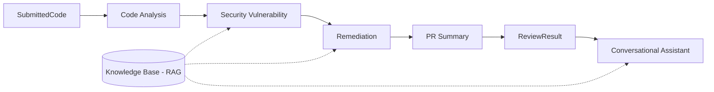

# Agent Responsibilities (Planned - Milestones 2-5)

> **Milestone 1 status:** these agents are **design only**. No agent is implemented yet. What exists today is the input module, the knowledge base and the data models they will use.

Each agent has a single clear job, a defined input and a defined output (the dataclasses in `models/`). Agents communicate only through those objects, which keeps them independent and testable.

| # | Agent | Input | Output | Uses RAG? | Uses LLM? |
|---|-------|-------|--------|-----------|-----------|
| 1 | Code Analysis Agent | `SubmittedCode` | Quality `Finding`s + code structure summary | Light (smell guidance) | Optional |
| 2 | Security Vulnerability Agent | `SubmittedCode` + analysis | Security `Finding`s | Yes | Yes (confirmation/explanation) |
| 3 | Remediation Agent | `Finding`s | `Remediation`s | Yes | Yes |
| 4 | PR Summary Agent | `Finding`s + `Remediation`s | `ReviewResult.pr_summary` | No | Yes |
| 5 | Conversational Code Assistant | `ReviewResult` + user question | Chat answer with citations | Yes | Yes |

## 1. Code Analysis Agent
**Purpose:** understand the code and find maintainability problems.
- Parse the code into a structure (functions, classes, imports, complexity) using `ast` for Python and a lightweight parser for Java.
- Detect code smells: long functions, deep nesting, duplicated code, magic numbers, unused imports, bare `except`, mutable default arguments, swallowed exceptions.
- Produce quality findings with line numbers and a structural summary for later agents.
- *Why first:* gives the security agent a map of the code (entry points, imports, function boundaries).

## 2. Security Vulnerability Agent
**Purpose:** find security weaknesses and map them to OWASP and CWE.
- Combine rule-based pattern checks (e.g. string-built SQL, `eval`, `os.system`, hardcoded secrets, `MD5`) with LLM reasoning to reduce false positives.
- Retrieve relevant knowledge-base chunks to justify each finding and cite OWASP sources.
- Output `Finding`s with severity, category (e.g. `A05:2025 Injection`), CWE id, line range, confidence and references.

## 3. Remediation Agent
**Purpose:** explain how to fix each finding.
- For each finding retrieve the matching secure-coding guidance (e.g. parameterised queries).
- Generate a short explanation plus a **corrected code example** in the same language.
- Output `Remediation` objects linked by `finding_id`, with an effort estimate and source URLs.
- Never applies changes automatically; suggestions are for the human reviewer.

## 4. PR Summary Agent
**Purpose:** write a pull-request-style review for humans.
- Summarise what the code does, group findings by severity, list the top fixes, and give an overall risk statement.
- Produce text suitable to paste into a PR description or export as a report.

## 5. Conversational Code Assistant
**Purpose:** let the user ask follow-up questions ("Why is line 12 dangerous?", "Show me a safer version").
- Keeps the conversation history and the current `ReviewResult` as context.
- Uses RAG to ground answers in the knowledge base and cites document names and URLs.
- Declines to run code; explains and suggests only.

## Interaction summary

## Milestone mapping (proposed)
| Milestone | Delivered |
|-----------|-----------|
| 1 (Weeks 1-2) ✅ | Knowledge base, architecture, code submission, RAG retrieval |
| 2 | Code Analysis Agent + Security Vulnerability Agent |
| 3 | Remediation Agent + orchestrator |
| 4 | PR Summary Agent + report export |
| 5 | Conversational Code Assistant, evaluation, polish |
