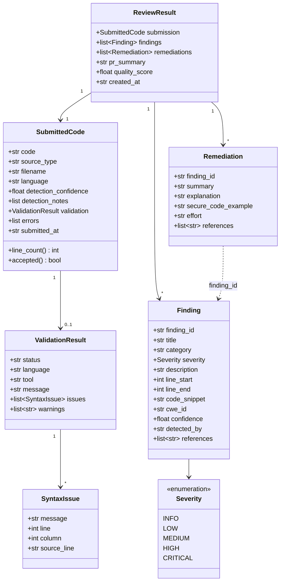

# Data Models

The dataclasses live in `models/`. `SubmittedCode` and `ValidationResult` are **used in Milestone 1**; `Finding`, `Remediation` and `ReviewResult` are **defined now as the contract for later milestones** (no component produces them yet).

## Field notes
| Model | Purpose | Milestone |
|-------|---------|-----------|
| `SubmittedCode` | The code plus how it was received, detected and validated | ✅ 1 |
| `ValidationResult` / `SyntaxIssue` | Syntax check outcome with line information | ✅ 1 |
| `Finding` | One vulnerability or quality problem; links to OWASP/CWE and KB sources | 🕒 2 |
| `Remediation` | Fix explanation and secure code example for one finding | 🕒 3 |
| `ReviewResult` | Everything about one review, ready for the UI, the PR summary and export | 🕒 3-4 |

## Knowledge-base records (implemented)
Each indexed chunk in ChromaDB stores its text plus this metadata:

| Field | Meaning |
|-------|---------|
| `source_file` | Document name, e.g. `sql_injection.md` |
| `title` | Document title |
| `section` | Nearest Markdown heading |
| `chunk_index` | Position of the chunk within the document |
| `source_urls` | Official source URLs (joined with `\|`) |
| `content_hash` | SHA-256 of the document, used to skip unchanged files on refresh |

`Retriever.search()` returns `RetrievedChunk(text, source_file, title, section, source_urls, score, chunk_index)`.

## Design notes
- Plain `dataclasses` keep the models dependency-free and easy to serialise (`to_dict()`).
- `Finding.references` carries knowledge-base URLs so every claim can be traced to an official source.
- `ValidationResult.status` distinguishes *invalid code* from *validator unavailable*, so a missing JDK is never reported as a code error.
