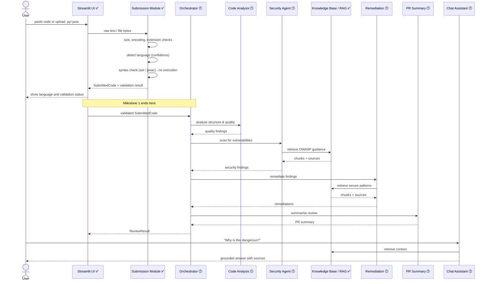
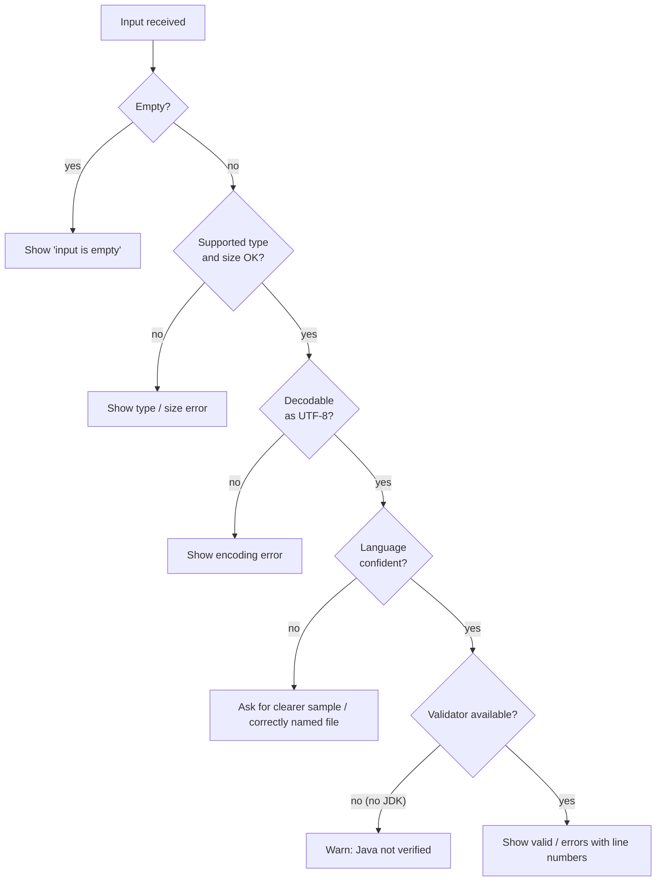

# Orchestration Flow (Planned)

> **Milestone 1 status:** only the first two steps (submission and validation) and the standalone knowledge-base search are implemented. The orchestrator itself is designed here and built in a later milestone.

## 1. End-to-end sequence

## 2. Step-by-step description
1. **Submit** - the user provides code (paste or upload).
2. **Pre-checks** - empty, unsupported type, bad encoding and oversized inputs are rejected with clear messages.
3. **Detect** - the language is inferred (no dropdown). If it is unclear, the user is asked for a clearer sample.
4. **Validate** - Python via `ast`, Java via `javac`. Code that does not parse is reported with line numbers; later agents are not run on it (or run in a "best effort" mode - a decision for Milestone 2).
5. **Analyse** - Code Analysis Agent produces structure and quality findings.
6. **Secure** - Security Vulnerability Agent produces security findings, backed by retrieved OWASP guidance.
7. **Fix** - Remediation Agent explains and demonstrates fixes.
8. **Summarise** - PR Summary Agent writes the review.
9. **Discuss** - Conversational Code Assistant answers follow-up questions about the `ReviewResult`.

## 3. Orchestrator design
- A simple, deterministic **pipeline controller** (not free-form agent chat) so results are repeatable and easy to explain.
- Each stage receives and returns typed objects from `models/`.
- A failing agent is recorded in the result and the pipeline continues where possible (graceful degradation).
- Stages that need an LLM check that an API key/model is configured and otherwise fall back to rule-based output.

## 4. Error-handling flow (implemented for submission)

