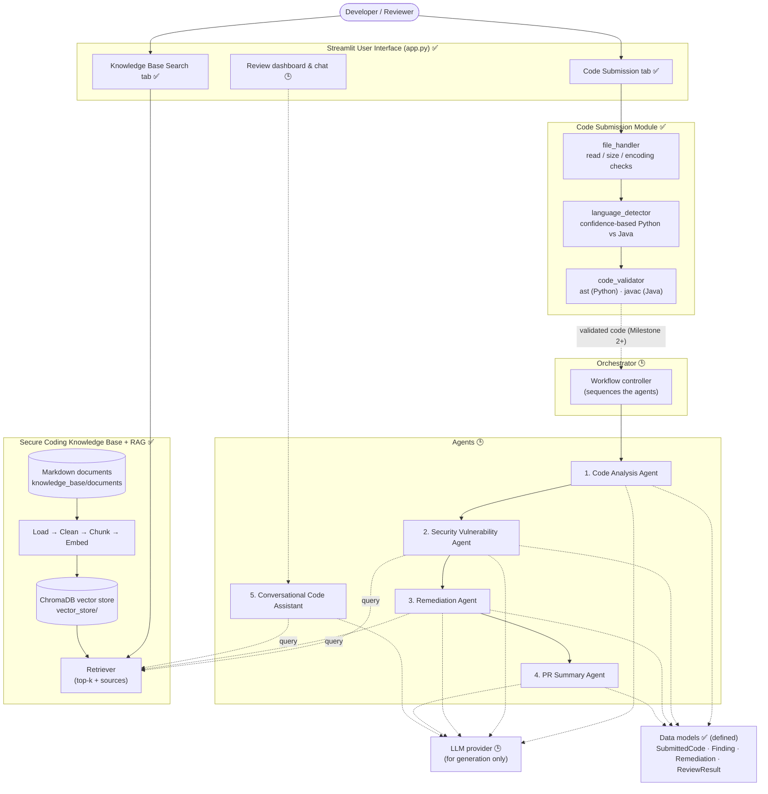
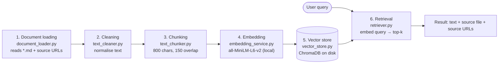

# System Architecture

> **Legend** - ✅ **Implemented in Milestone 1** · 🕒 *Planned for later milestones*

## 1. Project goal
The **AI Code Review & Security Analysis Agent** accepts Python or Java source code, reviews it for security vulnerabilities and code-quality problems, explains how to fix them using a secure-coding knowledge base, and produces a pull-request-style review. It is built as several cooperating agents that share one data model and one knowledge base (RAG).

## 2. High-level architecture

### Explanation in simple language
1. The user pastes code or uploads a `.py`/`.java` file in the **Streamlit UI**.
2. The **Code Submission Module** safely reads it, **detects the language automatically**, and checks the **syntax without ever running the code**.
3. Only syntactically valid code will be passed on (from Milestone 2) to the **orchestrator**, which runs the five **agents** in order.
4. The agents look up secure-coding guidance in the **knowledge base** through **RAG**: documents are cleaned, chunked, embedded and stored in a vector database, then the most relevant chunks are retrieved for a question.
5. All components exchange the same **data models**, so findings, fixes and summaries fit together.

In **Milestone 1** the solid parts (UI tabs 1-2, submission module, RAG indexing and retrieval, data models, documentation) are built. The orchestrator, agents and LLM are designed but not yet implemented.

## 3. Layered view

| Layer | Responsibility | Milestone 1 status |
|-------|----------------|--------------------|
| Presentation | Streamlit pages | ✅ submission + KB search |
| Input handling | Read, detect, validate code | ✅ |
| Orchestration | Order and coordinate agents | 🕒 designed |
| Agents | Analysis, security, remediation, summary, chat | 🕒 designed |
| Knowledge / RAG | Documents, embeddings, vector store, retrieval | ✅ |
| Data models | Shared dataclasses | ✅ defined |
| Model access | LLM for generation | 🕒 |

## 4. RAG pipeline

### Explanation in simple language
- **Indexing (done once, refreshed when documents change):** load the documents → clean the text → cut it into overlapping pieces → turn each piece into a vector of numbers (an *embedding*) that captures its meaning → save pieces, vectors and source information in ChromaDB on disk.
- **Searching (every query, fast):** turn the question into a vector with the *same* model → ask ChromaDB for the closest pieces → show them with the document name and source URLs.
- The index is stored in `vector_store/`, so it persists between runs. Each document's hash is saved; **refreshing only re-embeds new or changed documents**.
- **Milestone 1 stops at retrieval.** In later milestones an LLM will receive the retrieved chunks to write grounded answers (the "generation" half of RAG).

## 5. Technology choices

| Need | Choice | Reason |
|------|--------|--------|
| UI | Streamlit | Fast to build, pure Python |
| Python syntax check | `ast` module | Parses without executing |
| Java syntax check | `javac` | Authoritative compiler; compile only |
| Embeddings | Sentence-Transformers (`all-MiniLM-L6-v2`) | Free, local, small, good quality |
| Vector DB | ChromaDB (persistent) | Simple, local, stores metadata |
| Tests | Pytest | Standard |

## 6. Security design decisions
- Submitted code is **never executed**; Python is only parsed and Java is only compiled in a temporary folder with annotation processing disabled (`-proc:none`).
- `javac` is called with an argument list (no shell), with a timeout.
- Size, encoding, binary and extension checks happen before any parsing.
- No API keys are required for Milestone 1; secrets (future LLM keys) come from environment variables, never from source code.
